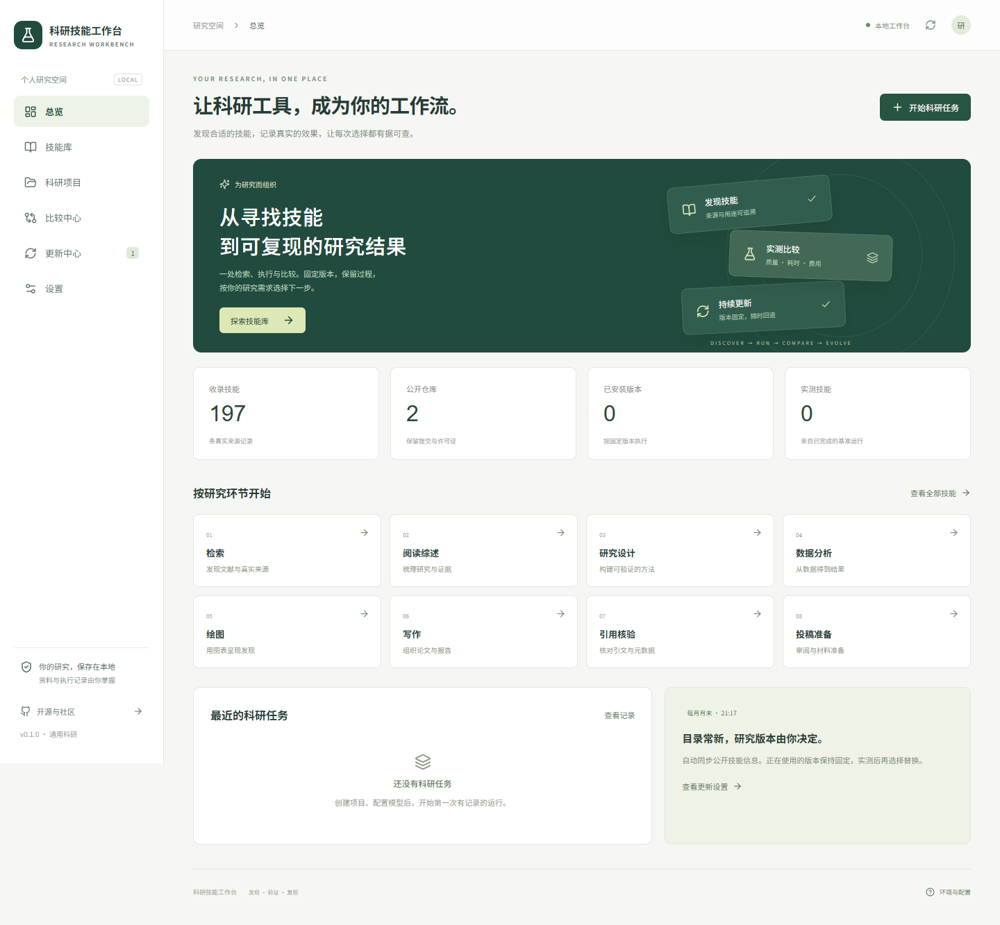

# 科研技能工作台 / Research Skills Workbench

中文、本地优先的科研技能管理与执行平台。发现技能 → 固定版本 → 执行任务 → 实测比较 → 手动替换或回退。

独立实现，功能参考“扣子说AI”的公开检索工作台演示。没有取得原作者源码或完整数据，不主张原作的界面、数据或规模。目录数字按真实来源统计；收录不代表实测有效。

首次部署请看 [中文部署与 GitHub 分支指南](docs/DEPLOYMENT.md)。



## 快速开始（Windows）

1. 安装 Python 3.12+、Node.js 24 和 Git。代码执行另需 Docker Desktop。
2. 下载或克隆本仓库。双击 `start.cmd`，或在项目目录运行 `powershell -ExecutionPolicy Bypass -File start.ps1`。
3. 打开 **http://127.0.0.1:8765**。首次启动安装依赖并构建前端，需联网；后续目录检索可离线使用。
4. 设置 → 添加模型，填写接口地址、模型标识及自己的 API 密钥。Ollama 地址通常为 `http://127.0.0.1:11434`，需要先拉取对应模型。
5. 付费模型填写人民币每百万 token 输入/输出价格及来源。价格未经官方自动核验，服务商账单以服务商记录为准。
6. 技能库 → 查看详情与许可证 → 安装 → 创建科研项目 → 上传资料 → 设置任务及预算 → 运行。

无需 API 密钥即可检索目录。平台不提供模型额度，不把 ChatGPT 订阅视为 API 额度。密钥加密保存在 `data/`，主密钥也在该目录；保护整个本地数据目录及备份，不对外共享。

## 代码执行

在根目录构建科研运行镜像：

```powershell
docker build -t research-workbench-runner:0.1.0 -f docker/runner.Dockerfile .
```

执行时固定镜像摘要。容器默认禁网、非 root、只读系统，输入只读，输出独立存放，限制 CPU/内存/时长。只支持镜像中已安装的依赖；缺失的专用依赖需要自行构建镜像，并在设置中选择。目录收录不能保证所有技能在基础镜像中可运行。

## 月末更新

公开仓库的 Actions 在每月最后一天北京时间 21:17 扫描；28—31 日先触发，再由程序判断月末。生成 `catalog/snapshot.json` 与 SHA-256 校验文件。只扫描公开来源，不调用付费模型，不读取本地科研数据。

在设置中填写自己的 `owner/repo`，本地每次启动每天最多检查一次快照。也可在更新中心立即同步或扫描。GitHub 的定时任务可能延迟，公开仓库长期不活动时可能停用，可从 Actions 页面手动恢复或运行。目录更新不改变安装版本；替换需主动操作。

## 比较与替换

提供文献与引用、数据分析、统计绘图、科研写作四种基准。技能比较固定模型；模型比较固定一个技能版本。默认三次重复，加入无技能基线。科研写作、图表语义需匿名人工评分；自动检查不等于学术正确性证明。

付费运行必须填写预算与价格。每次请求先预留保守费用，完成后按返回 token 结算；超时、取消或用量缺失时按预留值保守记账，可能高于实际费用。预算控制是本地估算控制，不能替代服务商账单限制。使用自己的服务商额度上限配合管理。

通过质量要求后才比较耗时与费用；不同配置的批次不合并排名。技能详情支持旧版比较、切换及项目级安装；更新中心可回退。不同技能替代也保存原版本历史。

## 来源与个人技能

默认来源见 `catalog/sources.json`。支持添加 GitHub 仓库、导入目录 JSON 和个人技能 ZIP。ZIP 使用顶层目录，例如 `my-skill/SKILL.md`，携带明确的许可证。个人包独立命名，不会被上游覆盖。技能格式参考 [Agent Skills](https://agentskills.io/specification)。

许可证按技能声明及局部文件优先，无法明确判断时仅索引来源。中文说明不足时显示原文与“待中文整理”；规则分类标示待复核。许可证自动识别是保守筛查，分发前仍须核对上游条款。

## Linux / macOS 与容器部署

```sh
python3 -m venv .venv
. .venv/bin/activate
pip install -r requirements.lock.txt
cd web && npm ci && npm run build && cd ..
python -m uvicorn server.main:app --host 127.0.0.1 --port 8765
```

`docker compose up --build -d` 提供目录与文本工作流的本地部署。代码执行推荐运行主机后端，再通过 Docker 启动隔离 runner；默认 Compose 不挂载 Docker socket。首版不提供公网多人账号，不应直接暴露到公网。

## 开发与测试

```sh
python -m pytest -q
python -m ruff check server scripts tests
cd web
npm test
npm run build
npm audit --omit=dev
```

API 文档：本地 `/docs`；接口统一 `/api/v1`，运行事件通过 SSE 推送。源码结构：`server/` 后端，`web/` 前端，`catalog/` 公共目录，`scripts/` 快照与检查，`tests/` 回归测试。

详见 [使用手册](docs/USER_GUIDE.md)、[架构与接口](docs/ARCHITECTURE.md)、[验收记录](docs/VERIFICATION.md)、[贡献指南](CONTRIBUTING.md) 和 [第三方说明](THIRD_PARTY_NOTICES.md)。

## 许可证与科研边界

平台原创代码 Apache-2.0；上游技能各自授权，平台许可证不覆盖第三方技能。引用、数据、统计与结论应由研究者复核，模型输出及单一基准结果不构成科研有效性证明。
